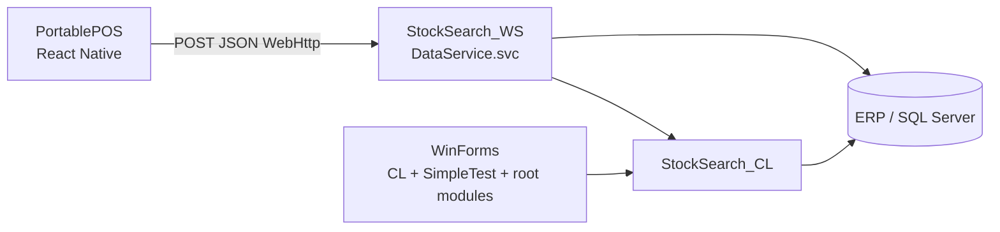

# Portable POS

Monorepo for the **Portable POS** product: a mobile client, a WCF web service, and Windows Forms tooling that share business logic against the ERP database.

## Repository layout

| Path | Role | Stack |
|------|------|--------|
| `PortablePOS/` | Android (and optional iOS) field app | React Native 0.70 |
| `StockSearch_WS/` | HTTP JSON API for devices | ASP.NET WCF (.NET 4.5, IIS) |
| `StockSearch_CL/` | Shared class library + WinForms admin UI | VB.NET (.NET 4.6.2) |
| `SimpleTest/` | Small WinForms harness referencing the CL | VB.NET WinExe |
| `PortablePOSBackend.sln` | Visual Studio solution (CL + WS + SimpleTest) | — |
| `FrmDO.vb`, `ModList.vb`, `ModVar.vb`, … | Legacy ERP WinForms modules at repo root (not in the `.sln` today) | VB.NET |
| `dev/` | Local scripts, references, and tooling (not required for production builds) | mixed |
| `StockSearch_WS/Scripts/` | SQL views/scripts for back-office database objects | T-SQL |

## Architecture



- **Mobile app** calls the WCF service over HTTP (see `PortablePOS/src/data/ServiceCall.js`):  
  `http://{server}//PortablePOS_WS/dataservice.svc/Web/{MethodName}`
- **WCF service** implements `IDataService` in `DataService.svc.vb` (login, stock, receiving orders, physical count, transfers, printing, etc.).
- **Class library** holds shared configuration and WinForms screens (`frmDashboard`, `frmSettings`, upload controls) used by the service and desktop tools.

## Prerequisites

### WCF web service (`StockSearch_WS`)

- Visual Studio 2019+ with **ASP.NET and web development** workload
- **IIS Express** or IIS with an app pool targeting .NET 4.x
- SQL Server access to the database (connection string in `Web.config`)
- **Crystal Reports** runtime (referenced by the WS project for document reprint)
- Deployed site path typically matches the virtual directory name **`PortablePOS_WS`**

Configure environment-specific values in `StockSearch_WS/Web.config`:

- `connectionStrings` / `AppConnectionString`
- `appSettings`: `CompCode`, `LocCode`, `ReportsFolder`, `ReceivingAppCode`, label printer settings, etc.

Run database scripts under `StockSearch_WS/Scripts/Backoffice/` on the ERP database as needed for new views/features.

### Windows Forms (`StockSearch_CL`, `SimpleTest`, root `.vb` sources)

- Visual Studio with **.NET desktop development**
- Target framework: **4.6.2** (CL and SimpleTest)
- Build order: **CL first**, then SimpleTest (SimpleTest references `StockSearch_CL.dll`)

Open `PortablePOSBackend.sln` and build **Debug** or **Release**.

Root-level forms/modules (`FrmDO.vb`, …) are part of the broader desktop codebase; wire them into a project or solution if you need them compiled from this repo.

### React Native app (`PortablePOS`)

- Node.js **16+** (LTS recommended for RN 0.70)
- JDK 11, Android Studio / SDK (API levels per `android/build.gradle`)
- Optional: Xcode for iOS

```powershell
cd PortablePOS
npm install
npm start
# separate terminal
npm run android
```

Point the app at your WCF host from the login / settings flow (server name or IP reachable from the device).

## Building and publishing

| Component | Typical output |
|-----------|----------------|
| WCF | Publish profile under `StockSearch_WS/My Project/PublishProfiles/` → IIS folder or server |
| CL | `StockSearch_CL/bin/{Configuration}/PortablePOS_CL.dll` |
| SimpleTest | `SimpleTest/bin/{Configuration}/SimpleTest.exe` |
| Mobile | `npm run android` → APK under `android/app/build/outputs/apk/` |

## Putting this solution in Git

This folder is intended to be a **single Git repository** containing all three stacks. A root `.gitignore` excludes build artifacts, `node_modules`, Gradle caches, and Visual Studio user files.

### First-time setup

```powershell
cd D:\PortablePOSBackend
git init
git add README.md .gitignore
git add PortablePOSBackend.sln
git add StockSearch_CL StockSearch_WS SimpleTest PortablePOS
git add FrmDO.vb ModList.vb ModVar.vb modprintrep.vb reprintslips.vb
# Add other tracked paths deliberately; avoid dev/gradle and build outputs (see .gitignore)
git status
git commit -m "Initial import: WCF service, WinForms, and React Native app"
```

Add a remote and push when ready:

```powershell
git remote add origin <your-remote-url>
git branch -M main
git push -u origin main
```

### Migrating from Team Foundation Server

`PortablePOSBackend.sln` still contains a `TeamFoundationVersionControl` section from TFS. Git ignores it; you may remove that block later for clarity. Do not commit `.vs/` or `*.user` files (already in `.gitignore`).

### Secrets and machine-specific config

- **`Web.config`** contains database and path settings. Prefer **encrypted connection strings** or environment-specific transforms; never commit plaintext production passwords.
- **`ReportsFolder`** and similar keys are machine-specific—document expected values for each environment instead of sharing personal paths.
- Review `Web.config` before the first push; use `git check-ignore -v` if unsure whether a file is excluded.

### What not to commit

- `bin/`, `obj/`, `node_modules/`, Android `build/`, `.gradle/`, `.vs/`
- Published WCF packages under `obj/Release/Package/`
- Large local caches under `dev/gradle/`
- APK/IPA artifacts unless your release process requires them in Git (usually use CI artifacts instead)

## Development notes

- WCF uses **webHttpBinding** with JSON (`WebInvoke`) for mobile clients; CORS/cross-domain is enabled on the binding for browser-style callers.
- Mobile offline login logic is aligned with the service (`SecurityData.js` references `DataService.svc.vb` salt/login rules).
- SQL view scripts in the WS project (`V_CPP_*`) must be applied on the ERP side before related API methods work.

## License / ownership

Internal project—add your organization’s license or contribution policy here if this repo is shared outside the core team.
